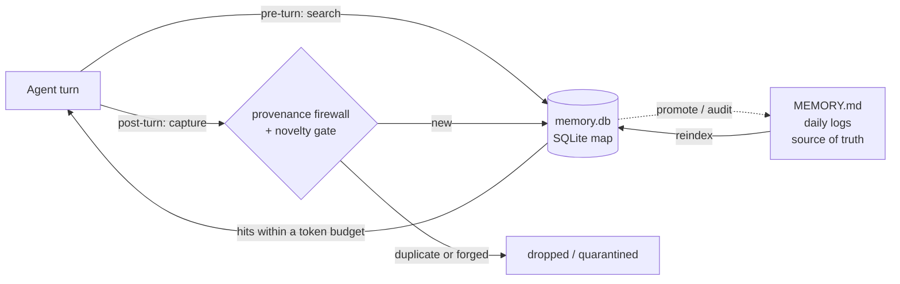

<div align="center">

# 🧠 memorykit

**Lightweight, auditable, offline-first long-term memory for AI agents.**

Markdown is the source of truth. A single SQLite file is the disposable map: vector + BM25 hybrid search, provenance firewall, novelty gate, dedup, supersede, graph edges and weights.

     

</div>



| | |
|---|---|
| **One file** | `memorykit.py` is the whole engine. Standard library only; `fastembed` optional for vectors. |
| **Token-lean** | Short ids, budgeted output, `get --text` on demand. Built for agents whose tokens are their lifespan. |
| **Paranoid by design** | Every memory carries speaker, provenance and source. Agents can't forge user quotes. Nothing phones home. |
| **Rebuildable** | Lose the DB? `reindex` rebuilds it from markdown. |

> **Roadmap: v5.0, in progress.** All upkeep (dedup, decay, GC, merge) moves into each turn's own calls: no end-of-day `sleep` or `end-session` pass, crash-safe journaling, and `memorykit upgrade` in place. See `CHANGELOG.md`.

---


A plug-and-play memory system for any agent. No content included —
you bring your own memories; this is the machinery.

## What it is

Three layers, one rule: **markdown is the source of truth, the vector
index is a disposable map of it.**

- `MEMORY.md` + daily logs + people/group pages: curated, hand-edited,
  authoritative. Templates in `templates/`.
- `memory.db`: a SQLite vector index that answers "what did we already
  know about X?" by meaning, not keyword. Rebuildable any time.
- `memorykit.py`: the whole engine in one file — capture, search,
  supersede, dedup, garbage collection, cross-layer audit.

Read `DESIGN.md` before changing the defaults. It explains the five
cascade failure modes this design defends against, and why each rule
exists.

## Requirements

- Python 3.10+ (standard library only for the core).
- For vector search: `pip install fastembed` — the embedding model
  (default `BAAI/bge-small-en-v1.5`) downloads once on first use.
  Without it, capture still works, search falls back to keyword
  matching, and `backfill` computes vectors later.

No server, no account, no key, no sync. Local-only by default.

## Quickstart

```bash
# 1. Create the empty index
python3 memorykit.py init

# 2. Capture turns (provenance is mandatory — see DESIGN.md)
python3 memorykit.py capture --speaker user --text "The photo folder is called Private"
python3 memorykit.py capture --speaker agent --text "I think the folder name matters" \
    --provenance agent-inferred --salience 6

# 3. Search before answering (automatic, never discretionary)
python3 memorykit.py search --query "photo folder name" --limit 5

# 4. Correct by superseding, never by silent overwrite
python3 memorykit.py capture --speaker user --text "Correction: the folder is called Quiet" \
    --supersedes <old-id>

# 5. Nightly tidy (dry-run first, always)
python3 memorykit.py gc            # dry run
python3 memorykit.py gc --apply    # quarantine below-floor entries
python3 memorykit.py dedup         # dry run
python3 memorykit.py dedup --apply
python3 memorykit.py correlate --markdown MEMORY.md
```

## Commands

| Command | What it does |
|---|---|
| `init` | Create the empty database from `schema.sql`. |
| `capture` | Store a turn with provenance, salience, confidence, novelty gate, supersession wiring. |
| `search` | Hybrid recall (cosine + BM25, salience only tilts) over live entries. One terse line per hit; `--chars`, `--budget N` (tokens), `--verbose`. |
| `get` | Show one entry in full, including metadata. |
| `supersede` | Point an old entry at its replacement; old row kept, filtered from search. |
| `dedup` | Merge near-duplicates (three gates + identifier guard). Dry-run by default. |
| `gc` | Score every live entry; quarantine below-floor ones. `--restore ID` undoes one; `--eviction-report` lists quarantine-expired candidates for manual review. |
| `backfill` | Compute vectors for rows stored before an embedder was installed. |
| `correlate` | Audit curated markdown claims against the index; orphans reported, never deleted. Vector mode uses a cosine cutoff of 0.75 (`MEMORYKIT_CORRELATE_COS`), keyword mode 0.3 token overlap. |
| `feedback` | `--id ID --rating +1\|-1 [--comment]`. Feeds the U term in GC. |
| `promote` | `--id NOTE --evidence ID`. Turns a note into a fact only on a different, live, user-said or tool-observed entry that is not derived from the note. |
| `sleep` | Distill settled raw turns into semantic entries, verify, wipe, sweep. Dry run by default; `--apply`, `--settled-only`, `--distiller CMD`, `--no-sweep`. Runs automatically on capture when `MEMORYKIT_AUTO=1` (default). |
| `bench` | Read-only recall check on your own corpus: `--queries` is a JSON list of `[query, needle]` pairs. Prints R@1/3/5 and MRR. |
| `health` | Read-only status as JSON: raw backlog, half-finished distills, lock state, and log/DB drift. Exits 1 when something needs a look. |
| `end-session` | `--session S`. Closes a session; its turns settle and distill immediately. |
| `reindex` | Delete-and-rebuild the database from the markdown log alone (`--force` to replace an existing DB). |

Options: `--db PATH` (default `memory.db`, or the `MEMORYKIT_DB`
environment variable), `--session`, `--turn`, `--supersession-key
state:foo` (auto-retires prior versions with the same key),
`--parent-ids` (writes `derived_from` edges for cascade pruning),
`--check` (advisory contradiction search before capture),
`--protected` (exempt from GC and from cascade quarantine).
`MEMORYKIT_NO_EMBED=1` forces keyword mode. `--no-auto` on capture
skips the settled-turn check once; `MEMORYKIT_AUTO=0` turns it off.
Output is terse by default because readers pay for it in tokens; see
"Token economy" in DESIGN.md. `MEMORYKIT_VERBOSE=1` turns chatter back on.
Ids print short; any unique prefix of 6+ characters works as an id.
`get --text` prints just an entry's words.
Attribution: `capture --source NAME [--quote TEXT --quote-source NAME]`;
`search --source NAME`. Quotes are kept out of the indexed text.
Tuning: `MEMORYKIT_SETTLE_TURNS` (8), `MEMORYKIT_SLEEP_MIN_HITS` (2),
`MEMORYKIT_SNIPPET_CHARS` (200), `MEMORYKIT_CONFLICT_SIM` (0.85), `MEMORYKIT_SWEEP_EVERY` (50),
`MEMORYKIT_SLEEP_MIN_SALIENCE` (5), `MEMORYKIT_DISTILLER`.

## Rebuilding

The database is an index, not an archive. If it disagrees with the
markdown, the markdown wins:

Every capture and every state change (supersede, dedup merge, GC
quarantine, restore, feedback, promote) is appended to
`memory-log/YYYY-MM-DD.md` next to the database (override with
`MEMORYKIT_MD_DIR`). Each line is readable prose plus one
`<!-- mk:{...} -->` record. That log is enough to rebuild everything:

```bash
rm memory.db
python3 memorykit.py reindex
```

Edits made directly in SQLite bypass the log and will not survive a
rebuild. Change state through the commands.

## Tests

```bash
python3 test_memorykit.py   # runs every check with the embedder, then in keyword mode
```

Vector mode reports SKIP, not PASS, when fastembed isn't installed.

## Safety rules (binding)

- Never capture credentials, codes, key material, or private
  identifiers. This is not a vault.
- Never hard-delete by automation. Quarantine is reversible; eviction
  is a human decision.
- Never let agent-originated content promote itself to fact.
  Promotion needs independent evidence: the user restating it, or a
  tool observing it.
- Never auto-resolve a contradiction. Surface it, supersede
  explicitly.

## Files

```
memorykit.py            the engine (one file)
schema.sql              the index schema
DESIGN.md               the design: layers, failure modes, defenses
README.md               this file
test_memorykit.py       acceptance tests, both modes
config.example.json     tunable thresholds (copy to config.json if you wire one in)
templates/
  MEMORY.md             curated memory template
  daily-log.md          daily log template
  WORKING-MEMORY.md     shared group working-memory template
```


## Trust: what this kit does and doesn't do

Written for users who audit before they install.

- **Files it writes:** the SQLite DB you name, its markdown log directory
  (`memory-log/` next to the DB, or `MEMORYKIT_MD_DIR`), and a
  `<db>.sleep.lock` file while sleep runs. Nothing else.
- **Network:** none of its own. The optional embedder (`fastembed`)
  downloads its model once on first use. `MEMORYKIT_NO_EMBED=1` runs
  fully offline in keyword mode.
- **No telemetry, no background process, no daemon.** Work happens only
  inside a command you ran, including auto-sleep, which runs inside
  `capture`.
- **`--distiller` / `MEMORYKIT_DISTILLER` runs a shell command you
  supply.** That is the only place the kit executes anything external.
  Leave it unset and nothing runs.
- **Nothing is hard-deleted.** Wipes, supersessions, and GC are
  tombstones. Every one is in the log and can be restored, and `reindex`
  rebuilds the whole DB from the log.
- **The provenance firewall is enforced in code, not by prompt.** A
  distiller can change wording, never type or provenance. Header-shaped
  lines in its output are stripped, after NFKC normalization and
  removal of zero-width characters.
- **Stale locks clear themselves, visibly:** if the PID that holds a lock
  is gone (same host), or the lock is older than
  `MEMORYKIT_LOCK_TIMEOUT` (3600s), the next run clears it and prints
  that. A live lock is reported, never skipped silently.
- Single file, standard library plus optional `fastembed`. Read it.


## Install (v4.5)

```sh
sh install.sh            # checks Python >= 3.9, sqlite3, venv; offers to apt-get what is missing
sh install.sh --yes      # same, no prompt
sh install.sh --keyword-only   # no fastembed/numpy/model: BM25 search only
memorykit doctor         # re-check any time; --fetch-model downloads/loads the model
sh uninstall.sh          # removes program + venv + wrapper; never touches your memory.db/memory-log
```

Root installs to `/opt/memorykit` with the command at `/usr/local/bin/memorykit` and the model cache at
`/var/lib/memorykit/models`; a normal user gets `~/.local/share/memorykit`, `~/.local/bin`, `~/.cache/memorykit/models`.
The venv reuses system fastembed/numpy when present. The model cache is pinned (`MEMORYKIT_MODEL_DIR`) because
fastembed's default lives in `/tmp`, which tmpfs wipes on reboot. The schema is embedded in `memorykit.py`, so a
lone copy of the file works anywhere. `pip install .[vector]` also works (console script `memorykit`).

## Graph ops (v4.5)

Nodes are entries (weight = salience 1-10); edges are weighted and logged, so `reindex` rebuilds them.

```sh
memorykit relate --a ID --b ID [--predicate supports|contradicts|related|...] [--weight 0.8]   # 0 removes
memorykit weigh --id ID --salience 8      # or --delta -2
memorykit merge --keep ID --drop ID[,ID]  # supersede + move edges + record lineage; gc --restore undoes
memorykit quarantine --id ID --degrees 2 [--apply] [--reason "..."]   # walks edges + conflict links
memorykit quarantine --restore ID         # undo that whole sweep
memorykit quarantine --scan               # conflict / duplicate / overlap (cos >= MEMORYKIT_OVERLAP_COS, 0.92) pairs
```

Quarantine is reversible and never pulls down an exempt neighbor (salience >= 9 or protected); those are listed as held.
